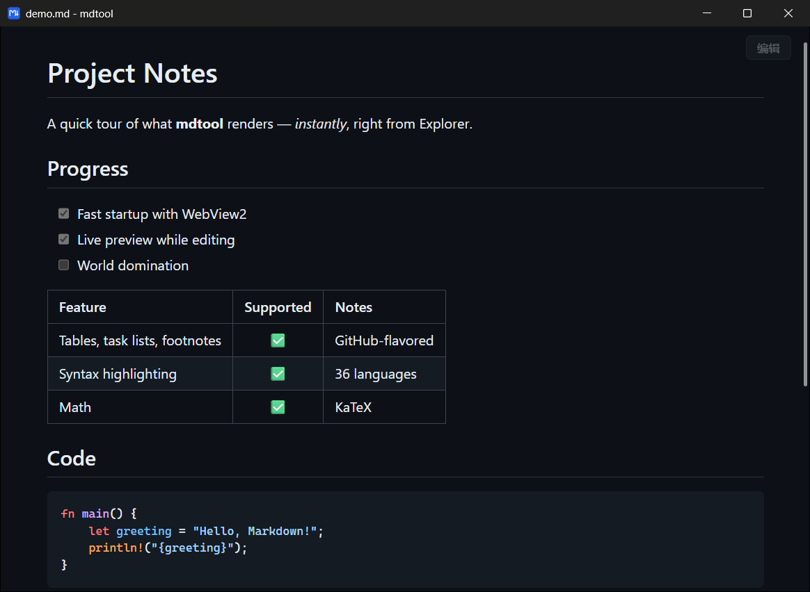
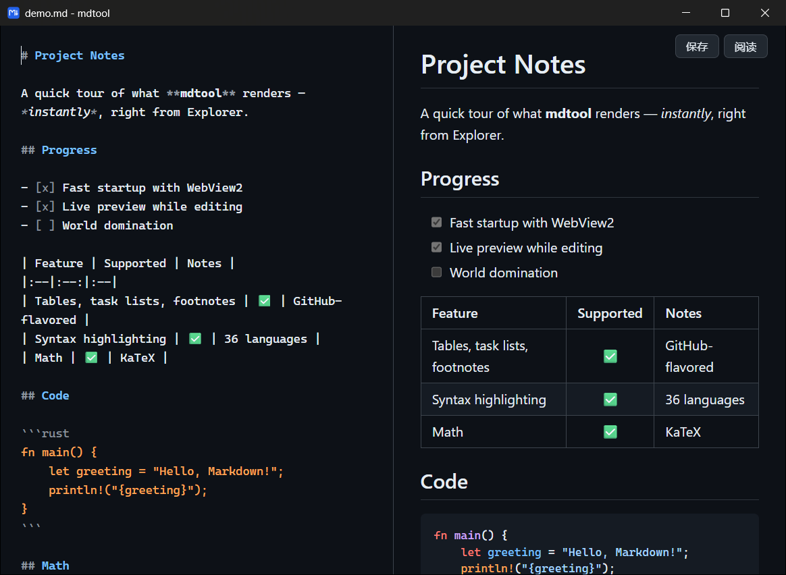

<p align="center">
  
</p>

<h1 align="center">mdtool</h1>

<p align="center">
  <b>Double-click a <code>.md</code> file. See it rendered in a quarter of a second.</b><br>
  A tiny, fast Markdown viewer &amp; editor for Windows.
</p>

<p align="center">
  <a href="../../releases/latest"></a>
</p>

<p align="center">
  
  
  
  
</p>

<p align="center">
  English · <a href="README.zh-CN.md">简体中文</a>
</p>

<p align="center">
  
</p>

---

## Why mdtool?

Windows has no good answer to "just *show* me this Markdown file". Notepad shows raw text, VS Code takes seconds to start, Typora is paid, and browser extensions need fiddly setup.

mdtool does one thing well: **it makes `.md` files open like images do** — instantly, rendered, in their own window. When you need to fix a typo, press <kbd>Ctrl</kbd>+<kbd>E</kbd>.

## Features

- ⚡ **Fast** — about **0.25 s** from double-click to rendered page (see [Performance](#performance))
- 📦 **Tiny** — a single ~2.4 MB `.exe`, fully offline, no runtime to install
- 🎨 **GitHub-style rendering** — follows your system's light / dark theme
- ✍️ **Built-in editor** — <kbd>Ctrl</kbd>+<kbd>E</kbd> opens a side-by-side editor with live preview and scroll sync
- 🧮 **Rich Markdown** — tables, task lists, footnotes, syntax highlighting (36 common languages), and LaTeX math via KaTeX
- 🖼️ **Local images just work** — relative paths like `../images/diagram.png` resolve correctly
- 🔄 **Live reload** — if another program changes the file, the window updates automatically
- 🛡️ **Safe by default** — never overwrites your unsaved edits, keeps the file's original encoding (UTF-8 / UTF-8 BOM / GBK), and blocks scripts embedded in documents

<p align="center">
  
  <br><sub>Edit mode: source on the left, live preview on the right.</sub>
</p>

## Installation

1. Download **`mdtool.exe`** from the [latest release](../../releases/latest).
2. Open a terminal in the download folder and run:

   ```powershell
   .\mdtool.exe --install
   ```

3. Windows will show an **"Open with"** dialog — pick **mdtool** and click **Always**.

That's it. Every `.md` and `.markdown` file now opens in mdtool.

> [!NOTE]
> **"Windows protected your PC"?** The executable isn't code-signed, so SmartScreen may warn you the first time. Click **More info → Run anyway**. You can also [build it yourself](#building-from-source) from source.

<details>
<summary><b>What does <code>--install</code> actually do?</b></summary>

<br>

Everything happens in your user account — **no administrator rights required**:

- Copies `mdtool.exe` to `%LOCALAPPDATA%\Programs\mdtool\`
- Registers it as an "Open with" option for `.md` / `.markdown` under `HKEY_CURRENT_USER\Software\Classes`
- Adds a startup entry for the [background helper](#performance) under `HKCU\...\CurrentVersion\Run`
- Opens the Windows "Open with" dialog (Windows 11 doesn't allow apps to set themselves as the default)

</details>

### Uninstall

```powershell
& "$env:LOCALAPPDATA\Programs\mdtool\mdtool.exe" --uninstall
```

This removes the file association and the startup entry. Then delete the `%LOCALAPPDATA%\Programs\mdtool` folder.

## Usage

| Action | What happens |
|---|---|
| Double-click a `.md` file | Opens it rendered, in reading mode |
| <kbd>Ctrl</kbd>+<kbd>E</kbd> | Toggle between reading and side-by-side editing |
| <kbd>Ctrl</kbd>+<kbd>S</kbd> | Save (keeps the original encoding) |
| <kbd>Ctrl</kbd>+<kbd>F</kbd> | Find in page |
| <kbd>Ctrl</kbd>+<kbd>Mouse wheel</kbd> | Zoom |
| Click a link | Web links open in your browser; links to other `.md` files open in a new mdtool window |
| Close with unsaved changes | mdtool asks whether to save first |

You can also run it from the command line: `mdtool.exe path\to\file.md`.

## Performance

Measured from process start to first rendered frame on the author's Windows 11 machine:

| Scenario | Time to rendered page |
|---|---|
| Background helper running *(default after install)* | **~0.25 s** |
| Cold start (no helper) | ~0.6 s |

Most of a cold start is spent launching the WebView2 browser engine. To skip that, `--install` registers a small hidden **background helper** (`mdtool.exe --background`) that starts when you log in and keeps WebView2 warm. Every file you open then reuses it.

The trade-off is roughly **160 MB of RAM** held in the background. If you'd rather not have it, disable **mdtool** in *Task Manager → Startup apps*. Everything still works, just with ~0.6 s startup.

## Requirements

- **Windows 11** (x64)
- Microsoft Edge **WebView2 Runtime** — preinstalled on Windows 11

Windows 10 with the [WebView2 Runtime](https://developer.microsoft.com/microsoft-edge/webview2/) should work too, but hasn't been tested.

## Privacy & security

- mdtool **never phones home**: no telemetry, no update checks. The only network requests are remote images that your documents link to.
- Markdown files may contain HTML. mdtool renders it, but a strict Content-Security-Policy blocks embedded scripts, event handlers, iframes, and forms. A malicious `.md` file can't run code or touch your files.
- Clicking a link to an executable file (`.exe`, `.bat`, `.ps1`, …) only reveals it in Explorer; it never runs it.

## How it works

```
mdtool.exe  ──reads & decodes──▶  your.md
    │
    ├─ tao        native window
    ├─ wry        WebView2 (the Edge engine built into Windows)
    │              └─ markdown-it · KaTeX · highlight.js · CodeMirror
    │                 all embedded in the .exe, lazy-loaded on demand
    └─ IPC        save · open links · close prompts · file watching
```

- **Rust** handles the window, file I/O (with encoding detection), the file watcher, and installation.
- The document is injected into the page before it loads, so first paint needs no round-trip.
- KaTeX, highlight.js, and the editor are only loaded when a document needs them.

## Building from source

Requirements: [Rust](https://rustup.rs/) (stable, MSVC toolchain) on Windows. Clone this repository, then:

```powershell
cargo build --release          # → target\release\mdtool.exe
cargo test                     # unit tests
```

The front-end libraries are vendored in `assets/vendor/`. To re-download them, run `sh scripts/fetch-vendor.sh` (e.g. from Git Bash).

### Troubleshooting

Set `MDTOOL_TIMING=1` before launching, and startup timings plus front-end errors are written to `%LOCALAPPDATA%\mdtool\timing.log`. Crashes are logged to `%LOCALAPPDATA%\mdtool\crash.log`.

## Roadmap

- [ ] English UI (button labels and dialogs are currently in Chinese)
- [ ] Code-signed releases
- [ ] Mermaid diagrams
- [ ] Export to HTML / PDF

Ideas and pull requests are welcome!

## Acknowledgements

mdtool stands on the shoulders of these excellent projects:

| Project | Used for | License |
|---|---|---|
| [tao](https://github.com/tauri-apps/tao) / [wry](https://github.com/tauri-apps/wry) | Window & WebView2 | MIT / Apache-2.0 |
| [markdown-it](https://github.com/markdown-it/markdown-it) | Markdown parsing | MIT |
| [markdown-it-footnote](https://github.com/markdown-it/markdown-it-footnote) | Footnotes | MIT |
| [markdown-it-task-lists](https://github.com/revin/markdown-it-task-lists) | Task lists | ISC |
| [markdown-it-texmath](https://github.com/goessner/markdown-it-texmath) | Math syntax | MIT |
| [KaTeX](https://github.com/KaTeX/KaTeX) | Math rendering | MIT |
| [highlight.js](https://github.com/highlightjs/highlight.js) | Syntax highlighting | BSD-3-Clause |
| [CodeMirror 5](https://github.com/codemirror/codemirror5) | Editor | MIT |
| [encoding_rs](https://github.com/hsivonen/encoding_rs) | GBK support | MIT / Apache-2.0 |

## License

[MIT](LICENSE)
